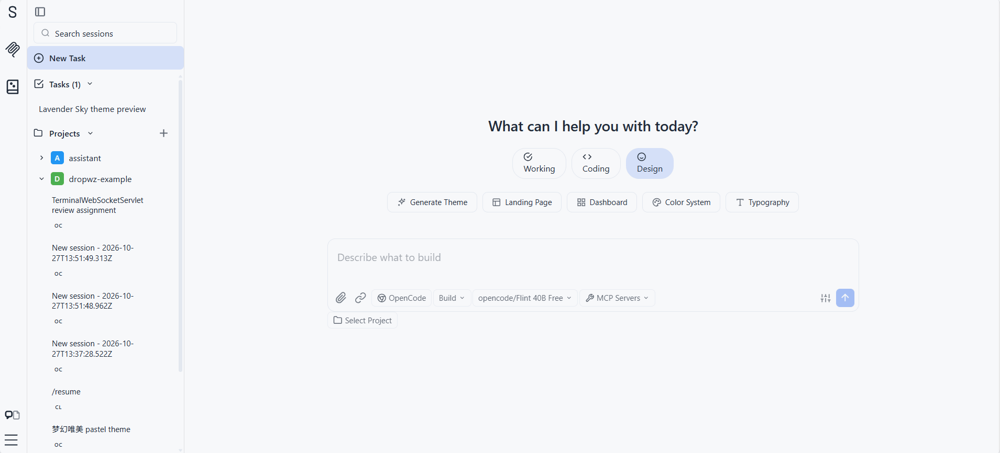
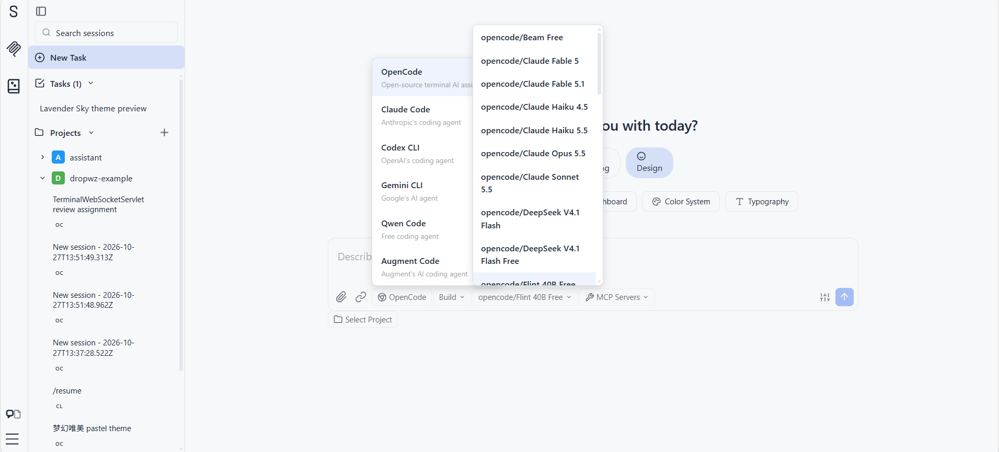
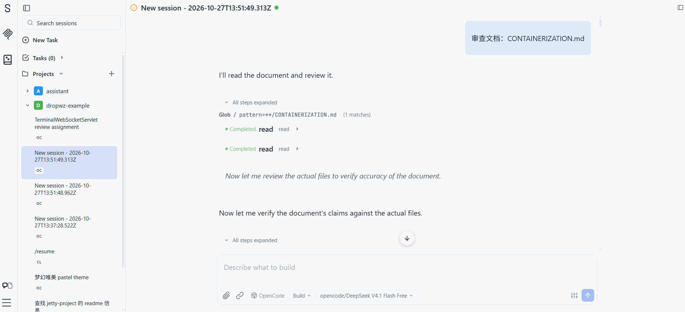
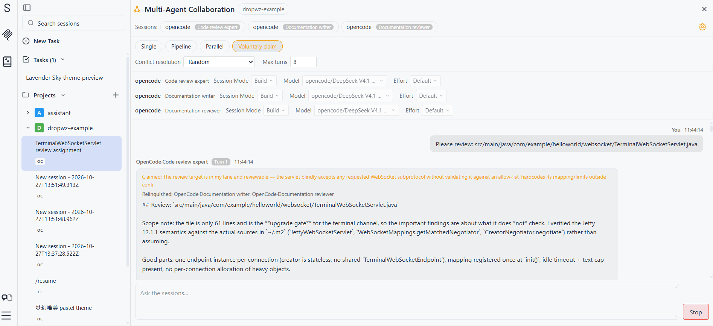

# Clover Monorepo

A universal development solution combining a browser web app with a local proxy Agent, built on the ACP protocol.

## Screenshots

| | |
|:---:|:---:|
| <br><sub>Welcome screen with one-click starters</sub> | <br><sub>Bring your own agent — OpenCode, Claude Code, Codex CLI, Gemini CLI, Qwen Code, Augment Code</sub> |
| <br><sub>AI-driven theme generation with live preview</sub> | <br><sub>ACP chat with visible tool calls</sub> |
| <br><sub>Editor, file tree and project sessions side by side</sub> | <br><sub>Multi-agent collaboration — pipeline, parallel and voluntary-claim orchestration</sub> |

## Repo Structure

```
clover-monorepo/
├── packages/
│   ├── server-rust/            # Local proxy server (crate `clover-server`, Rust)
│   │                           # axum + WebSocket + ACP + PTY + CLI `clover`
│   ├── server-legacy/          # Legacy TypeScript server (@julyware/clover-server)
│   │                           # Express + node-pty; kept for one release cycle
│   ├── assistant/              # Main app (clover): Angular 21 + SSR + Tauri shell
│   │                           # Editor / terminal / ACP client UI
│   ├── common/                 # Shared TypeScript library (@julyware/common)
│   ├── community-widget/       # Community widget
│   ├── clover/                 # Clover
├── docs/                       # Design documents
├── .opencode/plans/            # Feature plan documents
├── scripts/                    # Build scripts (build-with-timer.mjs, parity.mjs)
├── static/                     # Static assets
├── Cargo.toml                  # Rust workspace (server-rust + assistant/src-tauri)
├── pnpm-workspace.yaml         # pnpm workspace config
├── package.json                # Root package.json
└── README.md
```

## Tech Stack

- **Package Manager**: pnpm workspace + Cargo workspace
- **Runtime**: Node.js >= 22 (frontend / legacy server) and Rust (local server + desktop shell)
- **Frontend**: Angular 21 (SSR), TypeScript, Tailwind CSS
- **Proxy Agent**: Rust — axum, WebSocket, ACP (Agent Client Protocol), portable-pty
- **Desktop shell**: Tauri v2 (`packages/assistant/src-tauri`, crate `Clover64`)
- **Build Tools**: Cargo, tsup (legacy server), Angular CLI

> **Redis Note**: Redis is an optional dependency of the legacy TypeScript server that requires a separate Redis service deployment. By default, the application runs in memory mode without Redis subscriptions. To enable Redis, set the environment variable `REDIS_USE_MEMORY_FALLBACK=false`.

## Getting Started

```bash
# Install dependencies
pnpm install

# Start dev servers for all packages
pnpm dev

# Build the local proxy server (Rust)
cargo build -p clover-server

# Build everything
pnpm build
```

### Key Package Commands

```bash
# assistant main app
pnpm --filter ./packages/assistant start        # Dev server (HTTPS)
pnpm --filter ./packages/assistant build        # Build + style inlining + type declarations
pnpm --filter ./packages/assistant serve:ssr:clover  # Run SSR server

# server-rust local proxy (crate `clover-server`)
cargo run -p clover-server -- serve             # Headless server (127.0.0.1:4200)
cargo test --workspace                          # Rust unit + integration tests
node scripts/parity.mjs                         # Diff old TS server vs Rust server

# desktop shell (crate `Clover64`)
pnpm --filter ./packages/assistant tauri:dev    # Dev app (window loads ng serve on 4200)
cargo build --release -p Clover64 --features custom-protocol  # Standalone exe

# legacy TS server (frozen, kept for one release cycle)
pnpm --filter ./packages/server-legacy build    # tsup build
pnpm --filter ./packages/server-legacy dev      # Watch build
pnpm --filter ./packages/server-legacy test     # vitest run (CLI tests)
```

## CLI

The published `clover` binary (Rust) exposes two commands:

```bash
clover run "summarise the open PRs"   # Run one task with an installed agent, then exit
clover run --agent codex "…"           # Pick a specific agent
clover serve                           # Start the local server (same as no arguments)
```

Build it with `cargo build --release -p clover-server`; the GUI is packaged
separately as the `Clover64` crate by Tauri.

`clover run` drives the ACP session in-process — it never starts the web
server. Agent output goes to stdout (so it can be piped), library logs go to
stderr. Agents come from `~/.clover/acp.json`, which the web UI maintains; the
CLI never installs or modifies them.

| Option | Applies to | Description |
|--------|------------|-------------|
| `--agent <id>` | `run` | Run with this agent id (it must be installed) |
| `--root <dir>` | `run` | Workspace directory (default: current directory) |
| `--json` | `run` | Print raw session events as NDJSON |
| `--approve` | `run` | Approve permission requests automatically (default: deny) |
| `-p, --port N` | `serve` | Set the server port |
| `--readonly` | `serve` | Serve in read-only mode (no file writes) |

## Root Scripts

| Command | Description |
|---------|-------------|
| `pnpm build` | Build all packages (with timer) |
| `pnpm build:server` | Build the legacy @julyware/clover-server only |
| `pnpm build:clover` | Build the Rust `clover` CLI (`cargo build --release -p clover-server`) |
| `pnpm parity` | Diff the legacy TS server against the Rust server (all stages) |
| `pnpm dev` | Start all packages' dev servers in parallel |
| `pnpm test` | Run all packages' tests in parallel |
