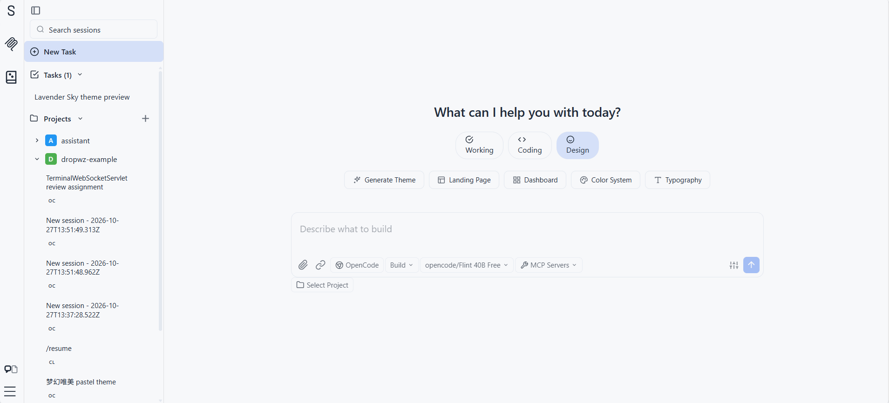
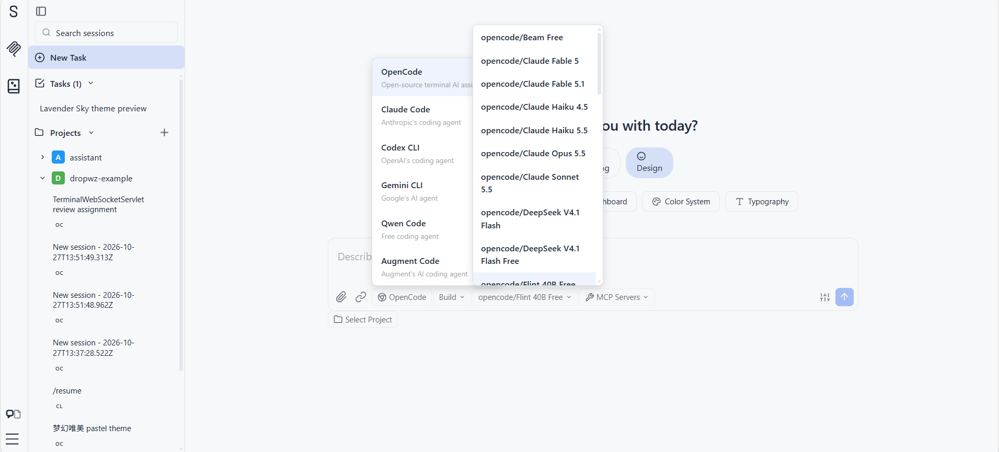
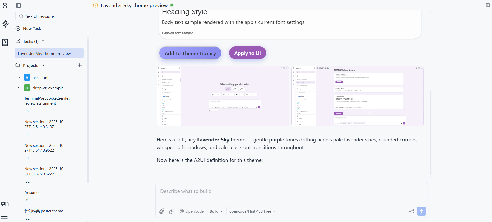
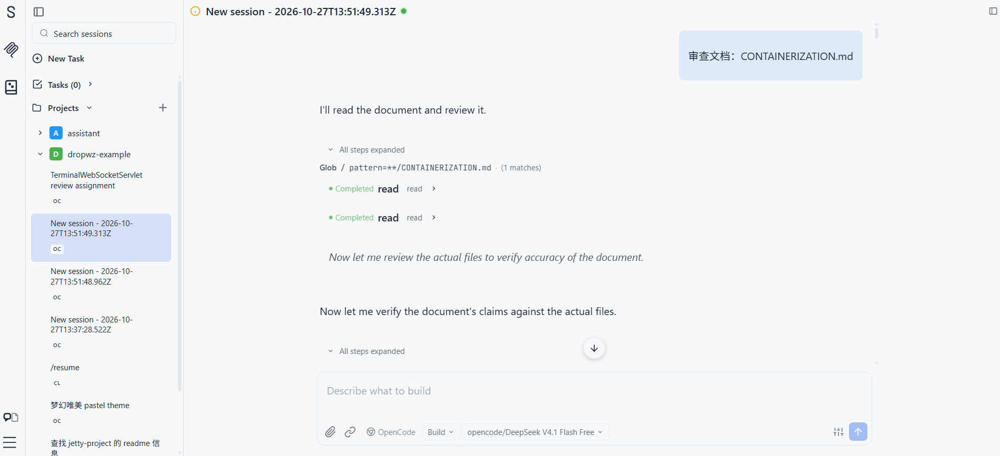
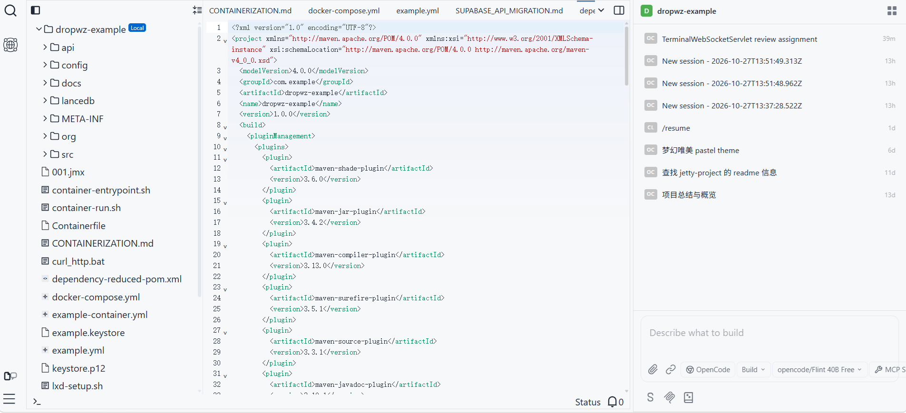
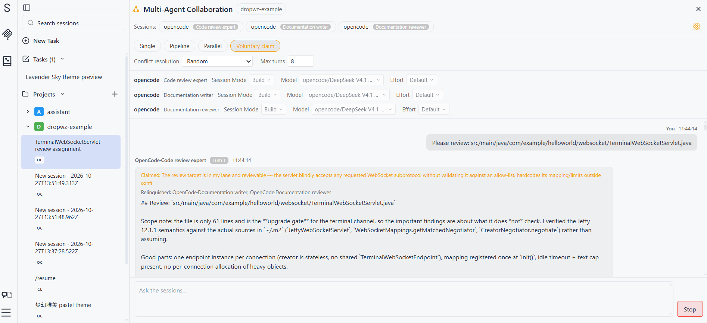

# Clover Monorepo

浏览器 Web 应用与本地代理 Agent 的通用开发方案（基于 ACP 协议）。

A universal development solution combining a browser web app with a local proxy Agent, built on the ACP protocol.

## 界面截图 / Screenshots

| | |
|:---:|:---:|
| <br><sub>欢迎页与一键起点</sub> | <br><sub>多 Agent 与模型选择：OpenCode、Claude Code、Codex CLI、Gemini CLI、Qwen Code、Augment Code</sub> |
| <br><sub>AI 驱动主题生成与实时预览</sub> | <br><sub>ACP 对话与可见的工具调用</sub> |
| <br><sub>编辑器、文件树与项目会话并排</sub> | <br><sub>多 Agent 协作 —— 流水线 / 并行 / 自愿认领编排</sub> |

## 仓库结构 / Repo Structure

```
clover-monorepo/
├── packages/
│   ├── server-rust/            # 本地代理 Server（crate `clover-server`，Rust）
│   │                           # axum + WebSocket + ACP + PTY + CLI `clover`
│   ├── server-legacy/          # 旧 TypeScript 实现（@julyware/clover-server）
│   │                           # Express + node-pty；保留一个发布周期
│   ├── assistant/              # 主应用（clover）: Angular 21 + SSR + Tauri 外壳
│   │                           # Main app: editor / terminal / ACP client UI
│   ├── common/                 # 共享 TypeScript 库（@julyware/common）
│   ├── community-widget/       # 社区挂件
│   ├── clover/                 # Clover
├── docs/                       # 设计文档
├── .opencode/plans/            # 功能方案文档
├── scripts/                    # 构建脚本（build-with-timer.mjs、parity.mjs）
├── static/                     # 静态资源
├── Cargo.toml                  # Rust workspace（server-rust + assistant/src-tauri）
├── pnpm-workspace.yaml         # pnpm workspace 配置
├── package.json                # 根 package.json
└── README.md
```

## 技术栈 / Tech Stack

- **包管理**: pnpm workspace + Cargo workspace
- **运行时**: Node.js >= 22（前端 / 旧版 server）与 Rust（本地 server + 桌面外壳）
- **前端**: Angular 21（SSR）、TypeScript、Tailwind CSS
- **代理 Agent**: Rust —— axum、WebSocket、ACP（Agent Client Protocol）、portable-pty
- **桌面外壳**: Tauri v2（`packages/assistant/src-tauri`，crate `Clover64`）
- **构建**: Cargo、tsup（旧版 server）、Angular CLI

> **Redis 说明**: Redis 为旧版 TypeScript server 的可选依赖，需独立部署 Redis 服务组件。默认情况下应用运行在内存模式，不走 Redis 订阅；如需启用 Redis，请设置环境变量 `REDIS_USE_MEMORY_FALLBACK=false`。

## 快速开始 / Getting Started

```bash
# 安装依赖
pnpm install

# 启动所有包的开发服务
pnpm dev

# 构建本地代理 Server（Rust）
cargo build -p clover-server

# 构建全部
pnpm build
```

### 关键子包命令 / Key package commands

```bash
# assistant 主应用
pnpm --filter ./packages/assistant start        # 开发服务器（HTTPS）
pnpm --filter ./packages/assistant build        # 构建 + 样式内联 + 类型声明
pnpm --filter ./packages/assistant serve:ssr:clover  # 运行 SSR 服务

# server-rust 本地代理（crate `clover-server`）
cargo run -p clover-server -- serve             # 无 GUI 起服务（127.0.0.1:4200）
cargo test --workspace                          # Rust 单元 + 集成测试
node scripts/parity.mjs                         # 新旧 server 逐字段对比

# 桌面端（crate `Clover64`）
pnpm --filter ./packages/assistant tauri:dev    # 开发模式（窗口加载 4200 的 ng serve）
cargo build --release -p Clover64 --features custom-protocol  # 单文件发布 exe

# 旧版 TS server（冻结，保留一个发布周期）
pnpm --filter ./packages/server-legacy build    # tsup 构建
pnpm --filter ./packages/server-legacy dev      # 监听构建
pnpm --filter ./packages/server-legacy test     # vitest run（CLI 测试）
```

## 命令行 / CLI

发布后的 `clover` 命令（Rust）提供两个子命令：

```bash
clover run "summarise the open PRs"   # 用已安装的 agent 跑一次任务后退出
clover run --agent codex "…"           # 指定 agent
clover serve                           # 启动本地服务（与不带参数时一致）
```

用 `cargo build --release -p clover-server` 构建；GUI 则以 crate `Clover64`
由 Tauri 单独打包。

`clover run` 在进程内直接驱动 ACP 会话，**不会启动 Web 服务**。agent 的输出走
stdout（方便管道消费），库的日志走 stderr。agent 来自 `~/.clover/acp.json`
（由 Web UI 维护），CLI 既不安装也不修改它们。

| 选项 | 适用 | 说明 |
|------|------|------|
| `--agent <id>` | `run` | 指定 agent id（必须已安装） |
| `--root <dir>` | `run` | workspace 根目录（默认当前目录） |
| `--json` | `run` | 以 NDJSON 输出原始会话事件 |
| `--approve` | `run` | 自动同意权限请求（默认拒绝） |
| `-p, --port N` | `serve` | 设置服务端口 |
| `--readonly` | `serve` | 只读模式（不写文件） |

## 根脚本 / Root Scripts

| 命令 | 说明 |
|------|------|
| `pnpm build` | 构建全部（带计时） |
| `pnpm build:server` | 仅构建旧版 @julyware/clover-server |
| `pnpm build:clover` | 构建 Rust `clover` CLI（`cargo build --release -p clover-server`） |
| `pnpm parity` | 新旧 server 逐字段对比（全部阶段） |
| `pnpm dev` | 并行启动所有包的开发服务 |
| `pnpm test` | 并行运行所有包的测试 |